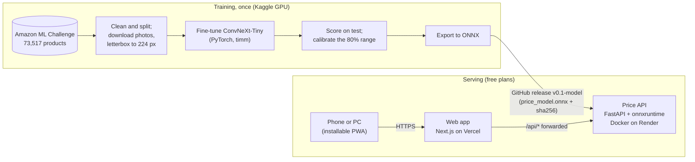
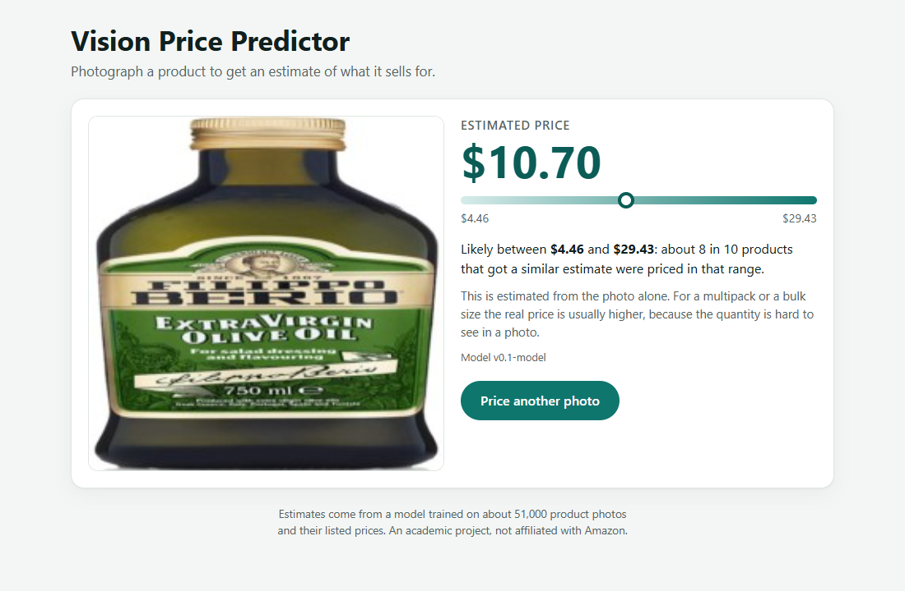
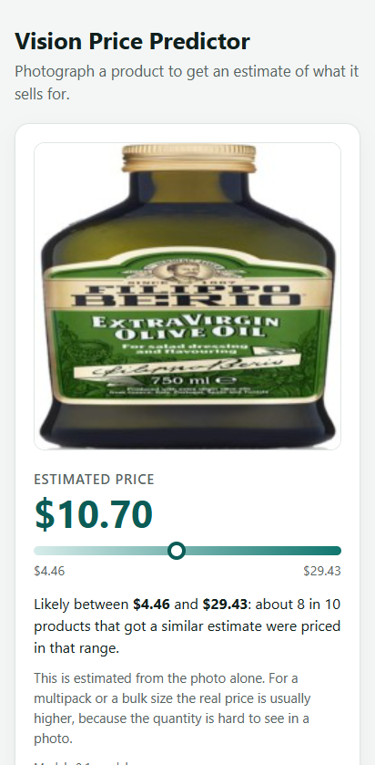
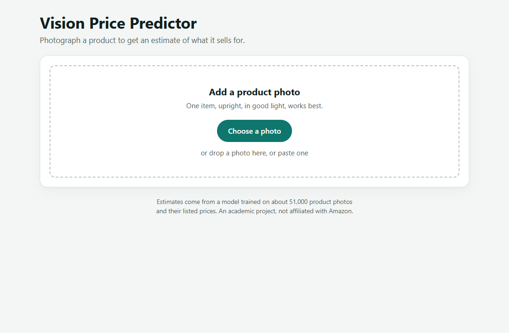
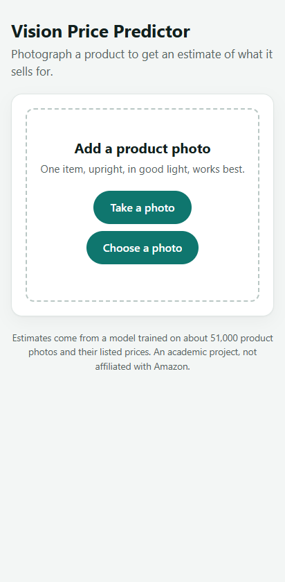

# Amazon Vision-Based Price Prediction System

Estimates what a product sells for from a photo of it: a fine-tuned vision
model behind an API, used through a web app that installs on phones and PCs.

[](https://github.com/Akash7762/Amazon-Vision-Based-Price-Predictor/actions/workflows/tests.yml)
[](https://github.com/Akash7762/Amazon-Vision-Based-Price-Predictor/actions/workflows/api-container.yml)
[](https://amazon-vision-based-price-predictor.vercel.app)
[](LICENSE)


**Try it: https://amazon-vision-based-price-predictor.vercel.app**

<p align="center">
  
</p>

The app runs on free hosting, which sleeps after 15 minutes without visitors:
the first photo after that can take up to a minute while it wakes.

## Problem statement

Pricing a product from its image alone is a hard regression problem. What
a photo shows (the kind of product, the packaging, the brand) is only loosely
tied to the price, and much of what sets a price (the pack size, the
quantity) is often not visible at all. The project asks how far a fine-tuned
pretrained vision model can get on that, measured honestly, and makes the
answer usable: a photo in, a price and a calibrated range out, on a phone.

## Solution overview

1. **Data.** 73,517 Amazon products with a photo and a price, from the
   [Amazon ML Challenge 2021](https://www.kaggle.com/datasets/suvroo/amazon-ml)
   dataset, cleaned and split 51,461 / 11,028 / 11,028 (train / validation /
   test), stratified by price.
2. **Model.** A pretrained ConvNeXt-Tiny with a single-output regression head,
   fine-tuned on Kaggle's free T4 GPU. A second run trained on log(price)
   didn't beat it, against a decision rule written down before the run.
3. **Evaluation.** Scored once on the 11,028 held-out test photos. The price
   range is calibrated on validation to hold 80% of real prices.
4. **Serving.** Exported to ONNX (no PyTorch needed to serve), behind a FastAPI
   service in a Docker container, and a Next.js web app that installs as a
   PWA.
5. **Testing and deployment.** Tested end to end in desktop and phone
   browsers, then deployed on free plans (Render and Vercel) and tested again
   there and on a real phone.

| On 11,028 held-out test photos | The model | Always guessing the median ($14) |
|---|---|---|
| Average error (MAE) | **$11.27** (95% interval $10.99–$11.56) | $14.51 |
| Median error | **$5.74** | $8.71 |
| SMAPE | 54.0% | 70.5% |
| 80% price range | held **79.6%** of real prices | |

The validation estimate was $11.23, so the test confirms it, and removing
every test photo that also appears in training gives $11.23 again. Details:
[`docs/evaluation.md`](docs/evaluation.md).

## Features

**Using it**

- Take a photo with the phone's back camera, or choose, drag in or paste one
  on a computer.
- An estimated price, a range that holds about 8 in 10 real prices, and a
  plain explanation of both.
- Installs like an app on Android, iPhone and desktop Chrome or Edge, and
  opens without a connection after the first visit.
- Clear messages when something goes wrong (not an image, too large, no
  connection, the service waking up), with "Try again" only where it helps.
- Accessible: no WCAG 2.2 AA issues found on any screen, light or dark, and
  usable with the keyboard alone.

**Under the hood**

- Photos are shrunk to 1600 px in the browser before upload, which saves
  data on phones and moves the price by only 1 to 2%.
- The API checks the model file's sha256 before it starts, turns phone photos
  upright, puts transparent images on white, and refuses bad uploads with
  clear errors (400 / 413 / 415).
- One image pipeline from training to serving (`model/preprocessing.py`), so
  the deployed app prices photos exactly as the evaluated model did.
- GitHub Actions run every test on every pull request, and build and
  load-test the API's Docker image under the free server's limits.

## Tech stack

| Layer | Choice |
|---|---|
| Model | PyTorch 2.14, `timm` 1.0.29 (`convnext_tiny.fb_in22k_ft_in1k`), trained on Kaggle (T4 GPU) |
| Serving the model | ONNX with `onnxruntime` (no PyTorch at serving time) |
| API | Python 3.12, FastAPI, Uvicorn |
| Web app | Next.js 16, React 19, TypeScript; installable PWA with a service worker |
| Tests | pytest; Playwright with axe-core, in Chrome, Edge and an emulated Android phone |
| Containers and CI | Docker, GitHub Actions |
| Hosting | Render (API, Docker) and Vercel (web app), free plans |
| Model file | `price_model.onnx` (112 MB) as a GitHub release asset, [`v0.1-model`](https://github.com/Akash7762/Amazon-Vision-Based-Price-Predictor/releases/tag/v0.1-model) |

## Architecture



What happens to a photo:

1. The web app shrinks it to at most 1600 px and sends it to `/api/predict`
   on its own address.
2. Vercel forwards `/api/...` to the API on Render, so the browser only ever
   talks to one site and there's no CORS to set up.
3. The API checks the upload, turns the photo upright, letterboxes it to
   224×224 on white exactly as in training, and runs the model.
4. It answers with the price, kept inside the training range ($1.32–$145.25),
   and the calibrated range for that price level.

Details: [`backend/README.md`](backend/README.md),
[`frontend/README.md`](frontend/README.md),
[`deploy/README.md`](deploy/README.md).

## Screenshots

<p align="center">
  
  &nbsp;
  
</p>

<p align="center">
  
  &nbsp;
  
</p>

## Installation

To run everything on your own computer. Needs **Python 3.12**, **Node.js 20.9
or newer** (developed on 24) and Git.

```bash
git clone https://github.com/Akash7762/Amazon-Vision-Based-Price-Predictor.git
cd Amazon-Vision-Based-Price-Predictor
python -m venv venv
```

Activate it (`venv\Scripts\activate` on Windows, `source venv/bin/activate`
elsewhere), then install what you need:

```bash
pip install -r backend/requirements-dev.txt
```

```bash
python backend/download_model.py
```

```bash
cd frontend && npm install
```

`backend/requirements-dev.txt` is enough for the app and its tests (no
PyTorch). For the data pipeline and training code as well, install
`requirements.txt` instead, which pins the CPU-only PyTorch. If GitHub's
download server is unreachable from your network, `download_model.py
--from-file` installs the model from a copy downloaded in a browser (see
[`backend/README.md`](backend/README.md)).

## Usage

**The live app:** https://amazon-vision-based-price-predictor.vercel.app.
On a phone, Chrome's menu has *Install app*, and Safari has *Share → Add to
Home Screen*.

**On your own computer.** On Windows, double-click `start-app.bat`: it starts
the API and the web app, opens the browser, and stops both when you press Q
or close its window (`start-app.bat -CreateShortcut` puts it on the desktop).
Elsewhere, from the repo root in two terminals, then open http://localhost:3000:

```bash
uvicorn backend.app.main:app --timeout-keep-alive 75
```

```bash
cd frontend && npm run dev
```

**The API directly.** Interactive docs at http://localhost:8000/docs, or:

```bash
curl -F "file=@photo.jpg" http://localhost:8000/predict
```

```json
{"price": 10.7, "currency": "USD", "range": {"low": 4.46, "high": 29.43, "coverage": 0.8}, "model_version": "v0.1-model"}
```

**The model on its own**, without the API (needs `onnxruntime`, `numpy` and
Pillow only):

```bash
python model/predict_onnx.py --model backend/models/price_model.onnx photo1.jpg photo2.jpg
```

**The tests:**

```bash
python -m pytest
```

```bash
cd e2e && npm install && npx playwright test
```

**Retraining.** The data pipeline runs locally (`scripts/`), and training,
evaluation and export run on Kaggle with the notebooks in `notebooks/`,
step by step in [`docs/kaggle_training_guide.md`](docs/kaggle_training_guide.md).

## Limitations

**The model**

- **It hedges toward typical prices.** It gets the order right, but its
  guesses move only about half as far as real prices: items under $5 are
  guessed $5.67 too high on average, items over $50 $40.33 too low.
- **It can't see what the photo doesn't show.** The worst misses are bulk and
  case quantities photographed as one unit; products sold in packs are
  guessed 4.5% lower than single items at the same price.
- **It reacts to how a product is turned.** On its side, a product can get
  twice its upright price, so the app asks for upright photos. Phone photos'
  rotation tags are applied, so they arrive upright.
- **Anything gets a price.** It can't tell a product from a non-product: a
  blank white image gets $39.10.
- **The ranges are wide** (median width $31) because that's what a photo
  alone can honestly support.
- Prices are in US dollars, learned from the dataset's Amazon listings, so
  estimates only make sense for the kinds of products in it.

**The free hosting**

- The API sleeps after 15 minutes without visitors; waking takes up to a
  minute (the app says so).
- Photos are priced one at a time, about a second each, so at busy moments
  they wait their turn.
- Vercel refuses uploads over 4.5 MB; photos are shrunk in the browser first,
  so only files the browser can't read are affected.
- No login or rate limit: anyone with the link can use it.

## Testing

| | |
|---|---|
| Backend and model | 57 tests, 23 of them with the real model against the evaluation code's reference prices |
| End to end | 37 Playwright tests in desktop Chrome, desktop Edge and an emulated Android phone (92 runs), on a local copy and on the live site |
| Accessibility | axe-core, WCAG 2.2 A and AA, 4 screens, light and dark: 0 issues |
| Real devices | camera, gallery and installing checked on a phone and a PC |
| Bugs found and fixed | 7, each with a test or a measurement showing the fix |

Full report: [`docs/testing.md`](docs/testing.md).

## Project structure

```
├── data/          # dataset documentation (the data itself isn't committed)
├── notebooks/     # EDA, and the Kaggle training and evaluation notebooks
├── scripts/       # data cleaning and splitting, image download, the demo GIF
├── model/         # training, evaluation, error analysis, ONNX export, preprocessing
├── backend/       # FastAPI service: /predict, /health
├── frontend/      # Next.js web app (installable PWA)
├── e2e/           # end-to-end tests (Playwright), test photos, screenshots
├── deploy/        # the API's Docker image, a smoke test, the deployment guide
└── docs/          # the reports below, and the README's images
```

## Documentation

| Document | What's in it |
|---|---|
| [`data/README.md`](data/README.md) | where the data comes from and how to regenerate it |
| [`docs/experiments.md`](docs/experiments.md) | the two training runs and how one was chosen |
| [`docs/evaluation.md`](docs/evaluation.md) | the test score, error analysis and what the model gets wrong |
| [`docs/kaggle_training_guide.md`](docs/kaggle_training_guide.md) | training and evaluating on Kaggle, step by step |
| [`backend/README.md`](backend/README.md) | the API: endpoints, errors, how the price range works, settings |
| [`frontend/README.md`](frontend/README.md) | the web app: how it talks to the API, installing it |
| [`docs/testing.md`](docs/testing.md) | what is tested, the bugs found and fixed, timings |
| [`deploy/README.md`](deploy/README.md) | the live deployment: setup, what was checked, the free plans' limits |
| [`CONTRIBUTING.md`](CONTRIBUTING.md) | how to work on the project |

## Roadmap

- [x] **Phase 0** — Repository and environment setup
- [x] **Phase 1** — Data collection and preparation
- [x] **Phase 2** — Model design, training, and one controlled experiment
- [x] **Phase 3** — Model evaluation, error analysis, export (`v0.1-model`)
- [x] **Phase 4** — FastAPI backend
- [x] **Phase 5** — Next.js PWA frontend
- [x] **Phase 6** — Integration and end-to-end testing (`v1.0`)
- [x] **Phase 7** — Deployment on Render and Vercel (`v1.1`)
- [x] **Phase 8** — Documentation and repo polish
- [ ] **Phase 9** — Final presentation

Every number in this repository comes from a run that was actually executed
and logged; none are estimated ahead of the run that produces them.

## License

[MIT](LICENSE). The dataset is the Amazon ML Challenge 2021 data from
Kaggle; product photos in this repository (test photos and figures) come from
it and are used for this academic project. Not affiliated with Amazon.
